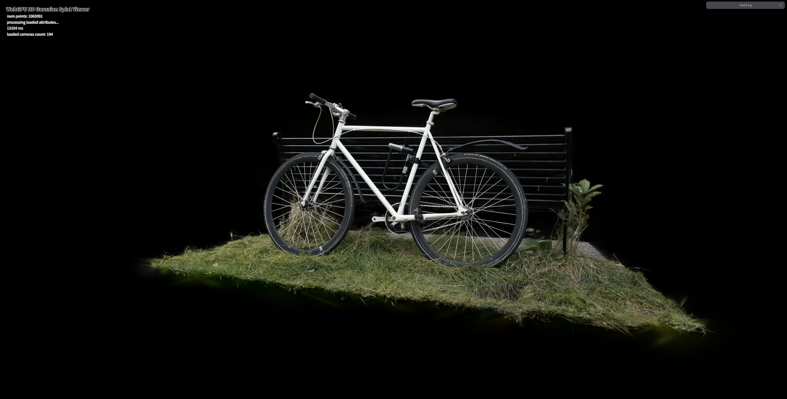
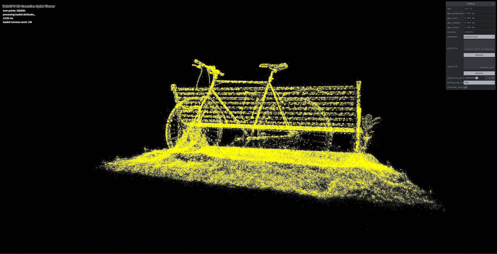
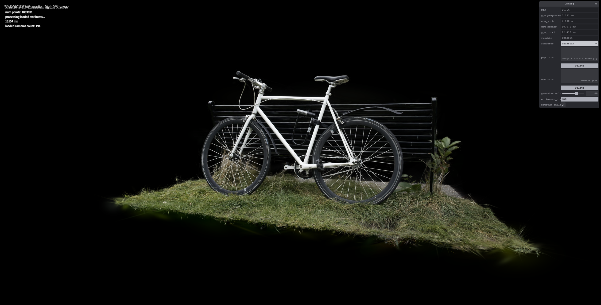
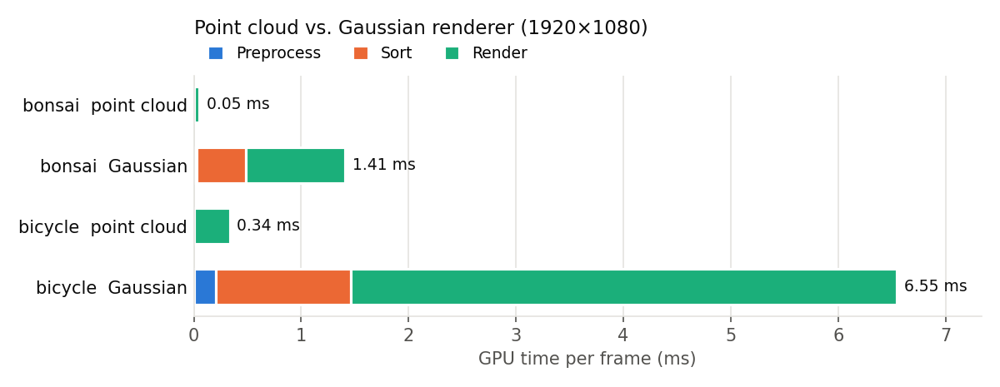
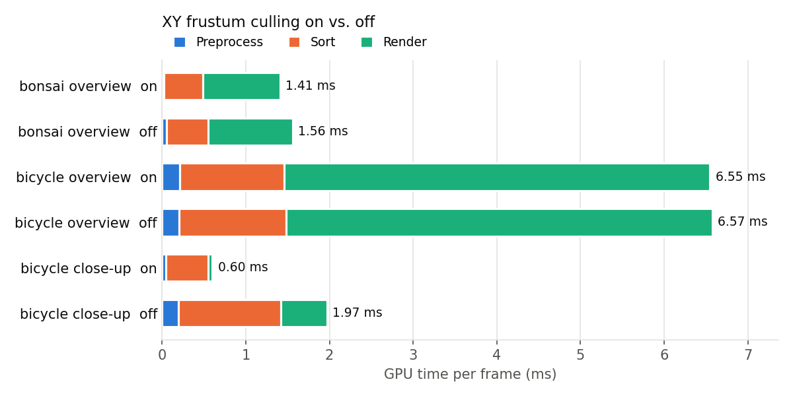
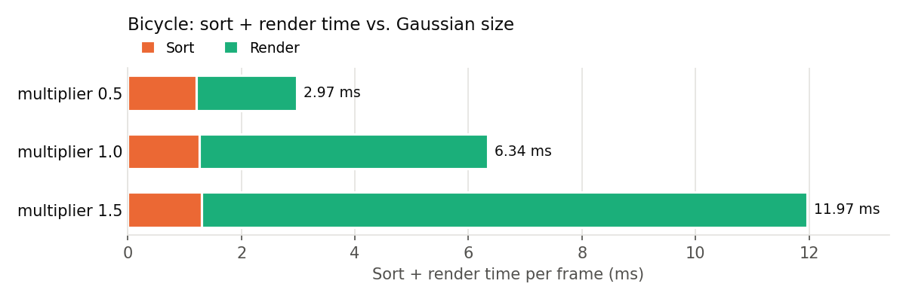
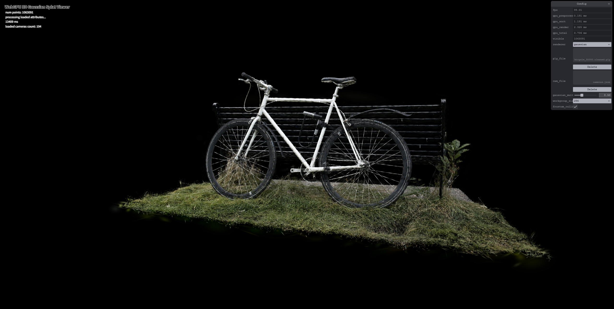
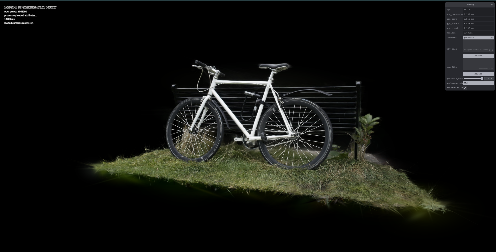

# Project5-WebGPU-Gaussian-Splat-Viewer

**University of Pennsylvania, CIS 565: GPU Programming and Architecture, Project 5**

* Yikai Li
* Tested on: **Google Chrome 156.0** on Windows 11, AMD Ryzen AI 9 365 @ 2.0GHz 32GB, NVIDIA GeForce RTX 5080 Laptop GPU 16GB (personal laptop)

### Live Demo

Open the link in Chrome, then load a `.ply` scene and its `cameras.json` with the panel on the right ([scene files](https://drive.google.com/drive/folders/1Fz0QhyDU12JTsl2e7umGi5iy_V9drrIW?usp=sharing)). Press `0`–`9` to switch camera presets.

### Demo Video

## Overview

A real-time 3D Gaussian Splatting viewer written in WebGPU. A trained scene is a set of 3D Gaussians, each with a position, rotation, scale, opacity and spherical-harmonics color. Every frame, the viewer projects them to the screen, sorts them by depth, and blends them back to front.

| Point cloud | Gaussian splatting |
|---|---|
|  |  |

## Features

**Part 1 – Point cloud**
- MVP transform in the point cloud vertex shader.

**Part 2 – Gaussian renderer** (three passes per frame)

1. **Preprocess (compute)**, one thread per Gaussian:
   - View frustum culling with a 1.2× screen bounding box, so Gaussians at the edge are kept. Points behind the camera or outside the near/far planes are always skipped.
   - 3D covariance from rotation, scale (`exp`) and the GUI multiplier.
   - 2D covariance by projecting with the Jacobian, then the conic, a 3σ radius, and the quad size in NDC.
   - View-dependent color from spherical harmonics (degree 3).
   - Opacity through `sigmoid`.
   - Writes a packed f16 splat (24 bytes), and uses `atomicAdd` to append its index and depth to the sort list.
2. **Sort**: GPU radix sort by depth (provided).
3. **Render**: one `drawIndirect` call; the instance count is the number of visible Gaussians, copied on the GPU. Each splat is a quad; the fragment shader evaluates the Gaussian with the conic and blends back to front.

**Performance tools** (added for the analysis)
- GPU time per stage (preprocess / sort / render) using timestamp queries, shown in the GUI. Unlike FPS, this is not capped by vsync.
- Number of visible Gaussians after culling.
- Switches for preprocess workgroup size and frustum culling. Changing them rebuilds the renderer without reloading the file.

## Performance Analysis

**Method.** All numbers are GPU times in milliseconds, measured with timestamp queries while rendering to a fixed **1920×1080** target. Each setting was warmed up, run for 2 s with the GPU fully busy, and repeated 3 times; the table shows the median. *Overview* is camera preset 0; *close-up* is the preset where culling removes the most Gaussians. Default settings: multiplier 1.0, workgroup size 256, culling on.

> Why not FPS: the browser caps FPS at the display refresh rate (~100 here), so a 2 ms frame and a 9 ms frame both show 100 FPS.

### Point cloud vs. Gaussian renderer

| Scene | Renderer | Drawn | Preprocess | Sort | Render | **Total** |
|---|---|---|---|---|---|---|
| bonsai | point cloud | 272,956 | – | – | 0.053 | **0.053** |
| bonsai | Gaussian | 112,048 | 0.024 | 0.463 | 0.922 | **1.409** |
| bicycle | point cloud | 1,063,091 | – | – | 0.336 | **0.336** |
| bicycle | Gaussian | 1,063,091 | 0.207 | 1.255 | 5.085 | **6.547** |

- **Look:** the point cloud only shows where the Gaussians are, as 1-pixel yellow dots with gaps. The Gaussian renderer gives a continuous, photo-like image with correct colors and soft edges.
- **Speed:** the Gaussian renderer is 19–27× slower. A point is one opaque pixel with no sorting. A Gaussian is a semi-transparent quad that can cover hundreds of pixels, needs a global depth sort, and computes `exp` and blending for every covered pixel. Rendering takes most of the time (65–78%).

### Effect of Preprocessing Workgroup Size

Preprocess time for each workgroup size (overview view):

| Scene | 32 | 64 | 128 | 256 |
|---|---|---|---|---|
| bonsai | 0.024 | 0.026 | 0.024 | 0.024 |
| bicycle | 0.206 | 0.205 | 0.207 | 0.207 |

No measurable difference. Only preprocess uses this setting (sort and render stay the same), and it is only ~3% of the frame. Each thread mostly reads memory (24 B of Gaussian data plus 96 B of SH coefficients) and does little math, so the kernel is limited by memory bandwidth, not by how threads are grouped. Even with 32 threads per group, 1 M Gaussians make over 30,000 workgroups, which is enough to keep every SM busy and hide memory latency. A very small or very large size could matter on other GPUs or smaller scenes.

### Effect of XY Frustum Culling

The switch only controls the side planes (the 1.2× screen box in x and y). Gaussians behind the camera or outside the near/far planes are skipped in both cases, because the projection math is not valid for them.

| Scene | View | Culling | Visible | Sort | Render | **Total** |
|---|---|---|---|---|---|---|
| bonsai | overview | on | 112,048 | 0.463 | 0.922 | **1.409** |
| bonsai | overview | off | 272,956 | 0.498 | 1.009 | **1.559** |
| bicycle | overview | on | 1,063,091 | 1.255 | 5.085 | **6.547** |
| bicycle | overview | off | 1,063,091 | 1.277 | 5.092 | **6.573** |
| bicycle | close-up | on | 50,709 | 0.507 | 0.047 | **0.601** |
| bicycle | close-up | off | 1,063,091 | 1.224 | 0.549 | **1.971** |

Yes, but it depends on the view. In the bicycle overview the whole scene is on screen, so nothing is culled and the time is the same. In the close-up only 5% of the Gaussians are visible, and culling makes the frame **3.3× faster**: the sort has fewer keys, and the vertex stage no longer processes a million off-screen quads. The gain is limited by a fixed sort cost of about 0.45 ms, which stays even with few keys.

*Another close-up (not the measured preset): only 87,532 Gaussians pass culling, but each covers a large part of the screen, so render takes 16 ms.*

### Number of Gaussians

| Scene | Total | Visible | Preprocess | Sort | Render |
|---|---|---|---|---|---|
| bonsai | 272,956 | 112,048 | 0.024 | 0.463 | 0.922 |
| bicycle | 1,063,091 | 1,063,091 | 0.207 | 1.255 | 5.085 |

Same bicycle scene, different Gaussian sizes (multiplier):

| Multiplier | 0.5 | 1.0 | 1.5 |
|---|---|---|---|
| Sort | 1.211 | 1.255 | 1.297 |
| Render | 1.759 | 5.085 | **10.675** |

| Multiplier 0.5 | Multiplier 1.5 |
|---|---|
|  |  |

Yes. Preprocess runs one thread per Gaussian, and sort handles one key per visible Gaussian, so both grow with the count. Sort grows more slowly than the count (9.5× the keys, 2.7× the time) because of its fixed cost of about 0.45 ms. Render time depends mainly on **how many pixels the quads cover**, not on the count alone: with the same number of Gaussians, making them 3× larger makes rendering 6× slower. More Gaussians usually means more overlapping layers to blend, so they are slower to render too. This is also why the close-up screenshot above renders slowly even with few Gaussians: each one covers a large part of the screen.

### Why f16 Preprocessing Would Barely Help

I did not implement the f16 extra credit. Here is why it would make little difference on this setup:

- **Preprocess is already small.** It takes ~3% of the frame (0.207 of 6.547 ms on bicycle). Even making it 2× faster would save only ~0.1 ms per frame.
- **The kernel is limited by memory, not math.** The input is already stored as f16, and each thread reads 120 B and does little arithmetic. Doing the math in f16 does not reduce the bytes read. The workgroup-size test points the same way: changing how threads are grouped had no effect.
- **The output is already f16.** Each splat is packed into 24 bytes, so render reads the same amount of data either way.
- **Not everything can use f16.** f16 has only ~3 significant digits and a maximum of 65,504. The 2D covariance (pixels², can reach hundreds of thousands), the determinant and conic, and the NDC position would have to stay in f32. Only the rotation, 3D covariance and SH color could switch.
- **It is not supported everywhere.** It needs the `shader-f16` feature, so an f32 fallback would still be needed for the live demo.

The real cost is sort and render (over 95% of the frame), which is what tile-based sorting with early termination would target.

## Implementation Notes

- **Splat layout (24 bytes, all f16):** NDC center, NDC quad size, RGBA color, conic + opacity.
- **Depth key:** `100 - z_view` (100 is the far plane). The radix sort is ascending, so far Gaussians come first and are drawn first.
- **Pixel offset:** each quad corner stores *center − corner* in pixels (x flipped, since NDC y points up and pixel y points down). The rasterizer interpolates it exactly, so the fragment shader gets *center − pixel* directly.
- **Safety checks:** out-of-range threads, Gaussians closer than the near plane (their radius would overflow f16), zero quaternions (NaN) and non-invertible covariances are skipped.

### Credits

- [Vite](https://vitejs.dev/)
- [tweakpane](https://tweakpane.github.io/docs//v3/monitor-bindings/)
- [stats.js](https://github.com/mrdoob/stats.js)
- [wgpu-matrix](https://github.com/greggman/wgpu-matrix)
- Special Thanks to: Shrek Shao (Google WebGPU team) & [Differential Guassian Renderer](https://github.com/graphdeco-inria/diff-gaussian-rasterization)
- Math references: [3D Gaussian Splatting paper](https://repo-sam.inria.fr/fungraph/3d-gaussian-splatting/), [Gaussian splatting notes](https://github.com/kwea123/gaussian_splatting_notes), [CUDA rasterizer](https://github.com/graphdeco-inria/diff-gaussian-rasterization/blob/main/cuda_rasterizer/forward.cu) (covariance, conic and falloff formulas), [spherical harmonics post](https://beatthezombie.github.io/sh_post_1/)
